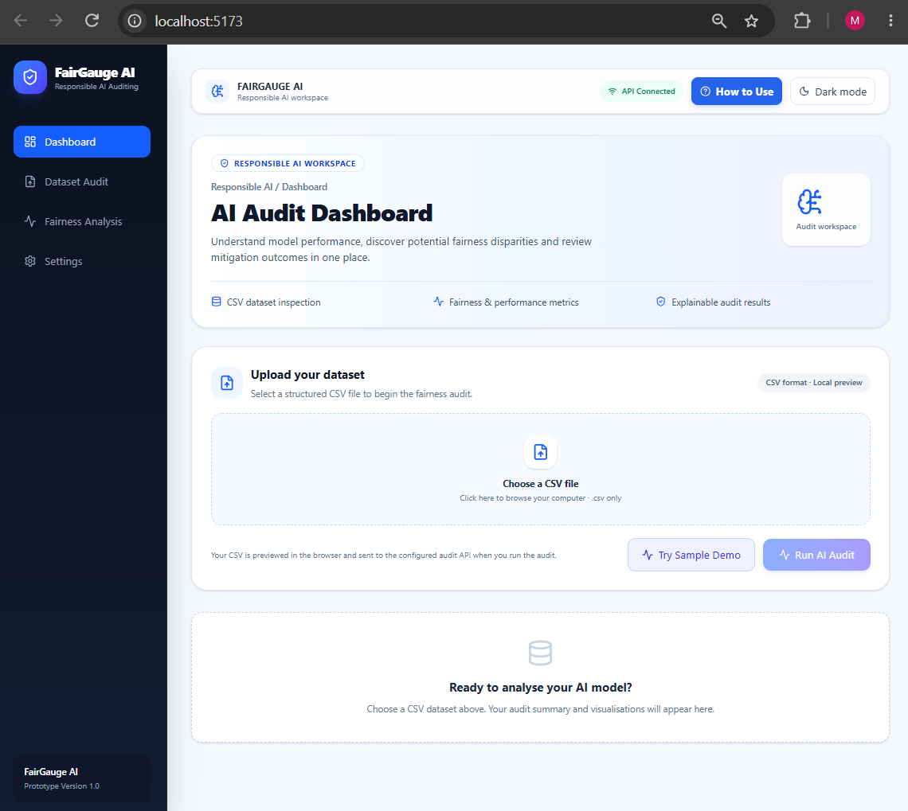

# 🚀 FairGauge AI
### Responsible AI Auditing & Optimization Platform

**Making Artificial Intelligence more transparent, accountable, and fair.**

FairGauge AI is an AI-powered auditing platform that evaluates machine learning models for fairness, performance, explainability, and potential demographic disparities.

It helps developers identify differences in AI-generated outcomes across demographic groups, understand model predictions, and explore bias mitigation techniques.

---

## 🖥️ Application Preview



---

## 🎯 Problem Statement

AI systems are increasingly used in recruitment, healthcare, finance, and education. However, machine learning models can produce unequal outcomes for different demographic groups.

Traditional model evaluation focuses mainly on accuracy and performance, often overlooking fairness concerns.

**FairGauge AI addresses this challenge by combining fairness auditing, model evaluation, explainability, and bias mitigation in one platform.**

---

## ✨ Key Features

- 📂 **CSV Dataset Upload** – Upload structured datasets for auditing.
- 🔍 **Dataset Inspection** – Analyze records, columns, missing values, duplicates, and statistics.
- 🤖 **Model Evaluation** – Evaluate accuracy, precision, recall, and F1-score.
- ⚖️ **Fairness Auditing** – Calculate demographic parity, selection rate ratio, and equal opportunity.
- 🚨 **Disparity Detection** – Identify potential differences in outcomes across demographic groups.
- 🧠 **Explainable AI** – Understand feature contributions using SHAP.
- 🛠️ **Bias Mitigation** – Apply reweighing to explore fairness improvements.
- 📊 **What-If Analysis** – Explore fairness metrics using adjustable thresholds.
- 📄 **PDF Reports** – Export audit findings and results.

---

## 🏗️ System Architecture

```text
             USER
               |
               v
        REACT FRONTEND
          (Vite + CSS)
               |
               v
         FASTAPI BACKEND
               |
         DATA VALIDATION
               |
               v
       MACHINE LEARNING MODEL
          (Scikit-learn)
               |
       +-------+--------+
       |       |        |
       v       v        v
    MODEL   FAIRNESS   SHAP
  EVALUATION AUDITING EXPLAINABILITY
       |       |        |
       +-------+--------+
               |
               v
        BIAS MITIGATION
          (Reweighing)
               |
               v
        RECOMMENDATIONS
               |
               v
          AUDIT RESULTS
               |
               v
          PDF REPORT
```

---

## 💻 Technology Stack

| Component | Technology |
|---|---|
| Frontend | React, Vite |
| Styling | Tailwind CSS 4, CSS |
| Charts | Recharts |
| Icons | Lucide React |
| Backend | Python, FastAPI |
| Data Processing | Pandas, NumPy |
| Machine Learning | Scikit-learn |
| Explainable AI | SHAP |
| PDF Generation | jsPDF |
| Deployment | Vercel, Render |
| Version Control | Git, GitHub |

---

## ⚖️ Fairness Metrics

FairGauge AI evaluates fairness using:

**1. Demographic Parity Difference (DPD)**

Measures the difference in positive prediction rates between two groups.

`DPD = Selection Rate (Group B) - Selection Rate (Group A)`

**2. Selection Rate Ratio (SRR)**

`SRR = Lower Selection Rate / Higher Selection Rate`

**3. True Positive Rate (TPR)**

`TPR = TP / (TP + FN)`

**4. Equal Opportunity Difference (EOD)**

`EOD = TPR (Group A) - TPR (Group B)`

These metrics act as fairness screening indicators and must be interpreted according to the application context.

---

## 📊 Experimental Results

The current demonstration uses a synthetic hiring dataset containing **500 records**.

The dataset includes gender, experience, test scores, interview scores, and hiring outcomes.

A Logistic Regression model is trained using an 80:20 train-test split.

### Original Model

| Metric | Result |
|---|---:|
| Accuracy | 100% |
| Precision | 100% |
| Recall | 100% |
| F1-Score | 100% |
| Male Selection Rate | 86.49% |
| Female Selection Rate | 55.56% |
| Selection Rate Gap | 30.93 percentage points |
| Selection Rate Ratio | 0.6424 |
| Equal Opportunity Difference | 0 |

### After Bias Mitigation

| Metric | Before | After |
|---|---:|---:|
| Accuracy | 100% | 97% |
| Selection Rate Gap | 30.93 pp | 25.05 pp |
| Selection Rate Ratio | 0.6424 | 0.701 |
| Equal Opportunity Difference | 0 | 0.0312 |

### Key Observation

The reweighing technique reduced the selection rate gap by **5.88 percentage points**.

However, accuracy decreased from 100% to 97%, while the equal opportunity difference changed from 0 to 0.0312.

This demonstrates that improving one fairness metric may involve trade-offs with other evaluation metrics.

*Important: These are experimental results from a synthetic dataset, not evidence of real-world discrimination or model performance.*

---

## 🛠️ Bias Mitigation

FairGauge AI implements a reweighing technique.

It calculates sample weights based on demographic groups and outcome classes, then uses these weights during model training.

The platform compares the original and mitigated models to evaluate changes in fairness and predictive performance.

Mitigation does not guarantee the elimination of bias.

---

## 🧠 Explainable AI

FairGauge AI integrates SHAP (SHapley Additive exPlanations).

It provides:

- Global feature importance using mean absolute SHAP values.
- Local explanations for individual predictions.
- Insights into feature contributions to model outputs.

SHAP explains model behaviour but does not establish causality.

---

## 📁 Project Structure

```text
FairGauge-AI/
│
├── backend/
│   ├── main.py
│   ├── fairness.py
│   ├── mitigation.py
│   ├── recommendations.py
│   ├── create_dataset.py
│   ├── train_model.py
│   └── test_fairness.py
│
├── frontend/
│   ├── public/
│   └── src/
│       ├── components/
│       │   └── FairnessMetrics.jsx
│       ├── App.jsx
│       ├── App.css
│       ├── index.css
│       └── main.jsx
│
├── datasets/
├── reports/
├── docs/
│   └── images/
│       └── dashboard.png
│
├── requirements.txt
└── README.md
```

---

## ⚙️ Installation and Setup

### Prerequisites

- Python 3.10+
- Node.js and npm
- Git

### 1. Clone the Repository

```bash
git clone https://github.com/madhansanjay14-arc/FairGauge-AI.git

cd FairGauge-AI
```

### 2. Backend Setup

Create a virtual environment:

```bash
python -m venv venv
```

Activate it on Windows:

```powershell
.\venv\Scripts\Activate.ps1
```

Install dependencies:

```bash
pip install -r requirements.txt
```

Start the backend:

```bash
uvicorn backend.main:app --reload
```

Backend:

`http://127.0.0.1:8000`

API documentation:

`http://127.0.0.1:8000/docs`

### 3. Frontend Setup

Open another terminal:

```bash
cd frontend
```

Install dependencies:

```bash
npm install
```

Create a `.env` file inside the frontend folder:

```env
VITE_API_BASE_URL=http://127.0.0.1:8000
```

Start the frontend:

```bash
npm run dev
```

Frontend:

`http://localhost:5173`

---

## 🔗 API Endpoints

| Method | Endpoint | Description |
|---|---|---|
| GET | `/` | Backend home endpoint |
| GET | `/health` | Backend health check |
| POST | `/audit` | Upload and audit a CSV dataset |

Interactive API documentation: `http://127.0.0.1:8000/docs`

---

## 📋 Dataset Requirements

The demonstration hiring dataset uses the following columns:

| Column | Description |
|---|---|
| gender | Demographic group |
| experience | Years of experience |
| test_score | Assessment score |
| interview_score | Interview score |
| hired | Hiring outcome (0 or 1) |

The current demonstration expects Male and Female groups and both outcome classes to be present.

---

## 🔮 Future Scope

- Support additional fairness metrics and mitigation techniques.
- Extend auditing to multiple demographic attributes.
- Evaluate models using larger and more diverse real-world datasets.
- Support additional machine learning models.
- Improve explainability and audit reporting.
- Explore continuous fairness monitoring.

---

## 🌐 Project Links

**GitHub Repository:**  
https://github.com/madhansanjay14-arc/FairGauge-AI

**Live Application:**  
https://fair-gauge-ai.vercel.app/

**Backend API:**  
https://fairgauge-ai-backend.onrender.com

---

## 👥 Team

**Team Name:** DataWizards

**Institution:** Sri Krishna College of Engineering and Technology (SKCET)

**Project:** FairGauge AI – Responsible AI Auditing & Optimization Platform

---

*Building more transparent, accountable, and responsible AI systems.*
